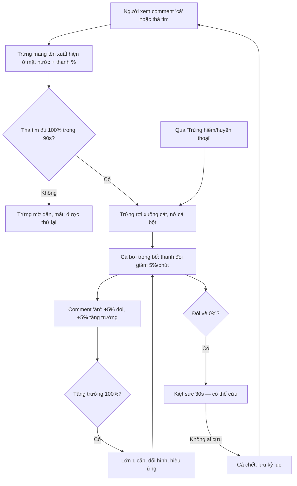

# BỂ CÁ HẠNH PHÚC — Kế hoạch mini game nuôi cá trên TikTok LIVE

> **Trạng thái:** draft v0.2 — đã có MVP lõi chạy được (Phase 2, chưa có quà tặng/tấn công). Ảnh cá mẫu đã duyệt.
> **Ngày:** 10/11/2026
> **Nền tảng:** Web (Next.js + Phaser), TikTok LIVE, Stage 1080 × 1920 (9:16) qua OBS.
> **Thư mục dự án:** `/Applications/MAMP/htdocs/be-ca-hanh-phuc` (tách riêng khỏi quán ăn).
> **Tham chiếu:** tái sử dụng hạ tầng của *Tiệm Ăn Hạnh Phúc* (`../tiem-an-hanh-phuc-main/docs/GDD.md`).

---

## 0. Kết luận khả thi

**Khả thi cao.** Mọi tín hiệu game cần đều có sẵn từ `tiktok-live-connector` và đã được adapter hiện tại chuẩn hóa:

| Cơ chế | Tín hiệu TikTok | Đã có trong code hiện tại |
|---|---|---|
| Thả tim để thả trứng | `like` kèm `user` + `count` | `server/adapters/source.ts` (type `like`), `game.ts#onLike` |
| Comment cho ăn, lệnh | `chat` | `server/chat-commands.ts` |
| Quà tặng → vật phẩm | `gift` + xử lý streak `repeatEnd` | `server/adapters/tiktok.ts` |
| Lưu cá xuyên phiên | ID TikTok ổn định | `server/store.ts` (SQLite) |
| MC đọc tên, báo cá sắp chết | TTS | `server/narrator.ts`, `voice.ts` |
| Demo không cần live | giả lập event | `server/adapters/demo.ts` |
| Sinh và tách nền ảnh | — | `scripts/gen-assets.sh`, `process-assets.ts` |

Ước tính **~60% hạ tầng dùng lại được**. Phần làm mới gồm: bể cá (Phaser scene), mô phỏng bơi, hệ thống cá (đói, tăng trưởng, tấn công), bộ art cá.

### Rủi ro cần biết trước

1. **Like bị gộp và có thể rơi.** TikTok gửi like theo lô (vài giây một lần, mỗi lô có `count`). Khi phòng đông, một phần like có thể không về connector. → Thanh thả trứng phải tính theo **số like nhận được**, ngưỡng chỉnh được trong Admin, không quá cao (đề xuất 60 like ≈ 10–20 giây nhấp).
2. **Spam comment “cho ăn”.** Nếu mỗi comment đều +5% thì người chơi spam 20 lần là lớn một cấp. → Bắt buộc **cooldown cho ăn theo từng người** (mục 3.4).
3. **Tấn công dễ bị hiểu là “trả tiền để phá người chơi free”.** Người xem free bị giết cá liên tục sẽ bỏ live. → Cần luật bảo vệ (mục 5.3).
4. **Bể đông thì rối.** Màn 9:16 chứa tối đa khoảng 60 cá có tên là còn đọc được. → Giới hạn số cá và giảm chi tiết nhãn theo mật độ (mục 6.4).
5. **Quà ngẫu nhiên giống “hộp may rủi”.** → Mỗi quà cho đúng một loại cá xác định, chỉ màu/hoa văn là ngẫu nhiên.

---

## 1. Tóm tắt trải nghiệm

Người xem comment **`cá`** (hoặc bắt đầu thả tim) → một **quả trứng có tên họ** xuất hiện ở mặt nước kèm thanh %. Người đó **nhấp thả tim liên tục** đến khi đầy thanh → trứng rơi xuống, nở thành cá bột mang tên họ. Từ đó họ **comment `ăn`** để cho cá ăn: thanh đói tăng lại và thanh tăng trưởng tiến lên. Đầy thanh tăng trưởng thì cá **lớn thêm một cấp, đổi hình dạng**. Cá to nhất bể đội **vương miện**. Bỏ đói đến 0% thì cá chết.

Quà TikTok cho: **trứng cá đẹp hơn**, **thuốc tăng trưởng**, **khiên**, **quyền tấn công**, **hồi sinh**, **mưa thức ăn cho cả bể**.

### Trụ cột

- **Của tôi:** tên mình trên đầu con cá của mình. Đây là lý do để người xem ở lại.
- **Chăm sóc:** đói giảm theo thời gian, nên người xem phải quay lại comment, giữ tương tác đều.
- **Khoe:** cá quà tặng nhìn khác hẳn, lớn lên càng lộng lẫy; vương miện cho cá to nhất.
- **Kịch tính có kiểm soát:** tấn công, khiên, cứu cá sắp chết là những khoảnh khắc hay để MC bắt lấy.

---

## 2. Vòng chơi



---

## 3. Luật chơi chi tiết (mọi số đều chỉnh được trong Admin)

### 3.1. Thả trứng bằng thả tim

| Tham số | Đề xuất | Ghi chú |
|---|---|---|
| Kích hoạt | comment `cá` / `thả cá`, **hoặc** lần thả tim đầu tiên của người chưa có cá | Cả hai cách đều mở trứng |
| Like cần để đầy | **60** | ≈ 10–20s nhấp; hạ xuống nếu phòng đông, like bị rơi |
| Thời hạn | 90s | Hết hạn: trứng mờ và vỡ; cooldown 30s rồi mới thử lại |
| Trứng chờ đồng thời | tối đa 8 | Thêm người thì vào hàng chờ; hiện “+N đang chờ” |
| Mỗi người | 1 cá sống tại một thời điểm | Muốn cá mới thì cá cũ phải chết (hoặc dùng quà “thay cá”) |

- Mỗi lô like của người đó làm thanh nhảy lên; có rung nhẹ và trái tim nhỏ bay vào trứng.
- Đầy 100%: trứng nứt sáng → rơi chậm qua làn nước → chạm cát → nở. MC gọi tên: *“Chào mừng bé cá của @tên!”*

### 3.2. Đói

- Bắt đầu 100%; **−5% mỗi phút** (100% → 0% sau 20 phút nếu không ăn).
- Dưới **30%**: cá bơi chậm, màu hơi nhạt, thanh đói nhấp nháy đỏ.
- Dưới **15%**: MC gọi tên một lần: *“Cá của @tên sắp đói lả rồi, comment ‘ăn’ đi!”* (có giới hạn tần suất).
- **0%**: trạng thái *kiệt sức* 30s, cá lật nghiêng và nổi dần lên. Comment `ăn` hoặc quà hồi sinh thì cứu được. Hết 30s thì chết.
- **Hết live thì đóng băng.** Đói chỉ giảm khi đang LIVE, để cá không chết qua đêm (xem câu hỏi Q1).

### 3.3. Tăng trưởng

- Mỗi lần cho ăn hợp lệ: **+5% đói, +5% tăng trưởng** (đúng ý tưởng gốc).
- Đầy 100% → lên cấp, thanh tăng trưởng về 0.
- Người đang ở hàng chờ mà thả tim thì tim được **giữ lại**, tới lượt là cộng vào trứng (đủ thì nở ngay).
- Thả tim khi đã có cá: mỗi 30 like **+1% tăng trưởng**, tối đa +5%/phút. Người xem vẫn có lý do nhấp tim, và lượt tim cũng giúp live lên đề xuất.
- Cấp cao có thể cần nhiều hơn (tùy chọn: hệ số ×1.0 → ×1.6 theo cấp) để cá to là thứ hiếm.

### 3.4. Cho ăn và chống spam

- Lệnh: `ăn`, `cho ăn`, `an`, `🍤`, `🐟` (không phân biệt hoa thường hay dấu).
- **Cooldown 20s mỗi người.** Comment trong cooldown không tính, không báo lỗi để tránh rác.
- Với cooldown 20s, tối đa 3 lần/phút = +15% tăng trưởng/phút → **~7 phút/cấp** cho người chơi free tích cực, **~50 phút** lên cấp tối đa. Phù hợp một buổi live 2–3 giờ.
- Hình ảnh: viên thức ăn rơi từ mặt nước ngay trên cá đó, cá lao lên đớp, có hạt lấp lánh nhỏ.

### 3.5. Các cấp kích thước (8 cấp)

| Cấp | Tên | Chiều dài trên Stage (px) | Hình dạng |
|---|---|---|---|
| 0 | Trứng | 84 (ở hàng trứng) | Quả trứng trong suốt, thấy mầm cá bên trong |
| 1 | Cá bột | 60 | Thân trong suốt, mắt to, túi noãn hoàng, chưa có vây rõ |
| 2 | Cá con | 78 | Hình cá rõ, màu nhạt, vây ngắn |
| 3 | Cá nhỡ | 98 | Màu loài bắt đầu hiện, hoa văn mờ |
| 4 | Thiếu niên | 122 | Hoa văn rõ, vây dài dần |
| 5 | Trưởng thành | 150 | Màu và vây đầy đủ |
| 6 | Cá lớn | 182 | Vây dài, thân đầy đặn, có ánh |
| 7 | Cá chúa | 224 | Hình thái “trùm”: vây lộng lẫy, hào quang theo bậc |

> Kích thước đã tăng ~1,5 lần so với bản đầu sau khi chạy thử: cá bột 36px quá nhỏ trên điện thoại.

- **Vương miện:** đội cho cá xếp hạng 1, so theo *cấp → % tăng trưởng → tuổi*. Mỗi lần đổi vua có hiệu ứng và thông báo. Cá hơn hẳn một cấp thì đổi ngay; cùng cấp thì chờ cooldown 60s để không nhảy liên tục.
- Header luôn hiện **Top 3 cá to nhất**.

---

## 4. Thiết kế hình ảnh — phần quan trọng nhất

### 4.1. Phong cách

Đồng bộ với game quán ăn: **đồ chơi 3D vinyl/đất sét mịn, chibi, ánh sáng dịu, màu ấm**, không viền đen. Khác biệt duy nhất: cá được vẽ **nhìn ngang (side view)** vì bể kính nhìn chính diện, không dùng góc isometric.

- **Bể:** bể kính lớn chiếm gần trọn khung 9:16, nền nước xanh ngọc nhạt chuyển lên xanh trời ở mặt nước, tia nắng (god rays) chuyển động chậm, hạt bụi lơ lửng, bọt khí từ máy sục.
- **Đáy bể:** cát kem, sỏi màu, rong và cây thủy sinh đung đưa, san hô đồ chơi, một ngôi nhà/lâu đài nhỏ, rương báu (mở ra khi có quà lớn).
- **Nhận diện chủ:** tên ở trên đầu cá, cỡ chữ theo LOD; viền tên đổi màu theo bậc cá (thường: trắng; hiếm: xanh; sử thi: tím; huyền thoại: vàng ánh kim).

### 4.2. Bậc cá: cá free “bình thường”, cá quà “phải đẹp”

Nguyên tắc: **cá free lớn chủ yếu về kích thước; cá quà lớn lên còn đổi hình dạng** (vây mọc dài, hoa văn, phát sáng, có hạt hiệu ứng riêng). Nhìn lướt cũng phải nhận ra ngay đâu là cá quà.

| Bậc | Cách có | Loài đề xuất (thiết kế gốc) | Điểm nhấn hình ảnh |
|---|---|---|---|
| **Thường** | Free (thả tim) | Cá vàng tròn, cá bảy màu, cá mún, cá tetra | Màu đơn giản, 4–6 biến thể màu để phân biệt; không hiệu ứng |
| **Hiếm** | Quà nhỏ | Cá betta đuôi lụa, cá thần tiên sọc | Vây dài mềm, màu gradient, ánh bóng nhẹ |
| **Sử thi** | Quà vừa | Cá koi trắng đỏ, cá đĩa (discus) ngọc | Hoa văn đẹp, vảy lấp lánh, vệt sáng theo đuôi |
| **Huyền thoại** | Quà lớn | Cá rồng ánh kim, cá phượng hoàng lửa, cá pha lê cực quang | Phát sáng, vây như lụa/lửa, hạt bay quanh, hào quang khi cá chúa |

Biến thể ngẫu nhiên chỉ ở **màu/hoa văn trong cùng loài**, để hai người cùng loài vẫn khác nhau.

### 4.3. Tiến hóa hình dạng (ví dụ cá rồng ánh kim)

1. **Trứng:** trứng vàng óng, vân vảy mờ, có tia sáng nhỏ.
2. **Cá bột:** trong suốt, ánh vàng, mắt to tròn.
3. **Cá con:** dáng cá rồng nhỏ, râu ngắn, vảy chưa rõ.
4. **Cá nhỡ:** vảy vàng hiện ra, râu dài hơn.
5. **Thiếu niên:** vây lưng dài, vảy viền đỏ.
6. **Trưởng thành:** vảy kim loại bóng, vây đuôi xòe.
7. **Cá lớn:** vây như lụa, hạt sáng bay theo.
8. **Cá chúa:** hào quang vàng, vây lửa, vệt sáng khi bơi.

Cá thường (ví dụ cá vàng tròn): trứng cam trơn → cá bột → cá con → … → trưởng thành vẫn là cá vàng dễ thương, chỉ to hơn và vây đầy hơn. Không hào quang.

### 4.4. Ngân sách asset (giữ khả thi)

Không vẽ đủ 8 cấp cho mọi loài. Dùng **hình khóa + phóng to**:

| Hình | Dùng cho cấp | Ghi chú |
|---|---|---|
| Trứng theo bậc (4 ảnh) | 0 | Thường / hiếm / sử thi / huyền thoại |
| Cá bột chung (1 ảnh, tô màu theo loài) | 1 | |
| Hình “cá con” mỗi loài | 2–3 | |
| Hình “thiếu niên” mỗi loài | 4–5 | |
| Hình “trưởng thành” mỗi loài | 6 | |
| Hình “cá chúa” mỗi loài **bậc hiếm trở lên** | 7 | Cá thường dùng ảnh trưởng thành phóng to |

→ Với 4 loài thường + 2 hiếm + 2 sử thi + 3 huyền thoại = 11 loài: khoảng **4 + 1 + 11×3 + 7 ≈ 45 ảnh cá**. Thêm khoảng 25 ảnh cho bể, đáy, đạo cụ, icon quà, VFX.

**Chuyển động không cần frame animation:** cá bơi bằng biến dạng lượn sóng thân và đuôi (mesh/rope hoặc shader của Phaser), cộng nghiêng theo hướng bơi. Cần kiểm tra API tương ứng trong **Phaser 4** ở bước spike. Một ảnh tĩnh mỗi hình là đủ, giúp sinh ảnh bằng AI dễ hơn nhiều.

### 4.5. Hiệu ứng trạng thái

| Trạng thái | Hiệu ứng |
|---|---|
| Nở trứng | Nứt sáng, mảnh vỏ, vòng bọt |
| Ăn | Viên thức ăn rơi, cá lao lên đớp, “+5%” nhỏ |
| Lên cấp | Cá phát sáng, vòng sóng, kích thước nảy (bounce), đổi hình, chữ “LỚN RỒI!” |
| Thuốc tăng trưởng | Bong bóng xanh lục bay quanh, viền phát sáng trong thời gian hiệu lực |
| Khiên | Bong bóng trong suốt ánh lam bao quanh cá, nhấp nháy khi sắp hết |
| Có quyền tấn công | Răng nanh nhỏ cạnh tên, mắt cá hơi “ngầu” |
| Tấn công | Cá lớn lao tới (dash), màn rung nhẹ, cá bé tan thành bọt và hồn cá bay lên |
| Kiệt sức | Lật nghiêng, nổi lên chậm, nhạt màu, icon “!” |
| Chết | Hồn cá (bong bóng trong) bay lên mặt nước rồi tan; tên mờ dần |
| Vương miện | Vương miện vàng xoay nhẹ trên tên, tia sáng lấp lánh |

---

## 5. Quà tặng → phần thưởng ✅ (đã làm; trứng sử thi chờ có loài mới)

> **Đã triển khai:** Thức ăn ngon (Rose), Nở ngay (Finger Heart), Khiên (Doughnut), Thuốc lớn (Hand Hearts), Răng nanh (Confetti), Mưa thức ăn (Corgi), Hồi sinh/bất tử (Money Gun), Trứng hiếm (Sunglasses), Trứng rồng (Galaxy). Tên/ID/giá sửa được trong Admin; quà chưa gán được ghi lại và (mặc định) quy đổi theo giá sang phần thưởng gần nhất. Trứng sử thi sẽ thêm khi vẽ xong loài bậc đó.

> Tên và giá quà TikTok thay đổi theo khu vực và thời điểm. Bảng dưới xếp theo **mức coin tham khảo**; mapping thật phải lấy từ danh sách quà khả dụng của phòng và chốt trong Admin (giống FR-TIKTOK-07 của game quán ăn).

### 5.1. Bảng đề xuất

| Mức coin | Phần thưởng | Tác dụng |
|---|---|---|
| 1 | **Thức ăn ngon** | +15% đói, +10% tăng trưởng, không tính cooldown. Chưa có cá: lấp 50% thanh trứng |
| ~5–10 | **Nở ngay** | Trứng thường nở tức thì, không cần thả tim |
| ~30 | **Khiên** | Chặn 1 lần tấn công, hiệu lực 10 phút |
| ~99 | **Thuốc tăng trưởng** | Tăng trưởng ×2 trong 5 phút, kèm +20% ngay |
| ~99 | **Răng nanh** | 1 lượt tấn công (mục 5.3) |
| ~199 | **Trứng hiếm** | Thả cá bậc hiếm. Đã có cá thì đổi loài, giữ nguyên cấp |
| ~299 | **Mưa thức ăn** | Cho cả bể ăn: mọi cá +20% đói. MC cảm ơn người tặng. Quà cộng đồng giúp người free thấy được lợi |
| ~499 | **Trứng sử thi** | Như trên, bậc sử thi |
| ~999 | **Hồi sinh / Bất tử 30 phút** | Cứu cá đang kiệt sức hoặc vừa chết (≤ 60s); hoặc miễn đói và miễn bị tấn công 30 phút |
| ~1000+ | **Trứng huyền thoại** | Cá huyền thoại, nở ở cấp 2, camera focus, rương báu mở |

- Xử lý streak đúng cách như game cũ: chỉ cộng phần chênh lệch, không cộng cả callback tạm lẫn callback kết thúc.
- Người tặng quà khi **chưa có cá** thì quà tự áp dụng cho trứng/cá sắp nở của họ (không mất quà).
- Hiển thị quà: cột dọc bên phải 5–6 ô (icon quà + icon vật phẩm + tên ngắn), xoay vòng nhóm. Giống game quán ăn để vận hành quen tay.

### 5.2. Hiển thị cá quà khác cá free

- Viền tên theo màu bậc, hào quang và hạt hiệu ứng riêng.
- Lần đầu nở: camera zoom nhẹ 3–4s, MC đọc tên người tặng và tên loài.

### 5.3. Tấn công và khiên

**Luật theo ý tưởng gốc:**
- Chỉ cá **to hơn** (cấp cao hơn) mới tấn công được cá **nhỏ hơn**. Cá bé không tấn công được cá to.
- Tấn công thành công: cá bé chết. Có khiên: khiên vỡ, cá bé sống.

**Cách ra lệnh:** sau khi có Răng nanh, comment `cắn @tên`. Không chỉ định trong 30s thì cá tự cắn cá nhỏ hơn gần nhất **không có khiên**.

**Luật bảo vệ (đề xuất mạnh, để không đuổi người xem free):**

| Luật | Đề xuất |
|---|---|
| Chênh lệch cấp | Kẻ tấn công phải hơn **ít nhất 2 cấp** (thay vì chỉ cần to hơn) |
| Bảo vệ người mới | Trứng và cá dưới 5 phút tuổi miễn nhiễm |
| Giới hạn bị cắn | Một cá chỉ bị tấn công tối đa 1 lần / 10 phút |
| Phần thưởng kẻ tấn công | +30% tăng trưởng (cá lớn hơn sau bữa ăn) |
| An ủi nạn nhân | Lần thả trứng tiếp theo chỉ cần 50% like; giữ kỷ lục cấp cao nhất |
| Bật/tắt | Admin bật/tắt cả chế độ tấn công theo buổi live |

> Nếu muốn giữ đúng “cá to cắn chết cá bé” không cần luật bảo vệ, chỉ cần đặt các tham số trên về 0 trong Admin.

---

## 6. Màn hình Stage 1080 × 1920

### 6.1. Bố cục

```
┌──────────────────────────────────────┐
│ HEADER: Logo · số cá · 👑 Top 3      │ ~150px
├──────────────────────────────────────┤
│ MẶT NƯỚC: hàng trứng đang nạp tim     │ ~220px  ← vùng thả trứng
│  🥚[▓▓▓░░] @an  🥚[▓░░░░] @binh ...  │
├────────────────────────────┬─────────┤
│                            │ QUÀ     │
│        BỂ CÁ               │ 🌹 Ăn   │
│   (cá bơi, tên, thanh)     │ 🛡 Khiên│
│                            │ 💊 Thuốc│
│                            │ 🥚 Hiếm │
│                            │ ...     │ cột quà ~200px
│  ~~~ rong, cát, lâu đài ~~~│         │
├────────────────────────────┴─────────┤
│ Gợi ý: “cá” · “ăn” · “cắn @tên”       │ trong safe area
└──────────────────────────────────────┘
```

- **Hàng trứng đặt ở mặt nước phía trên**, không đặt ở đáy, vì góc dưới bên trái màn TikTok bị lớp comment che. Trứng lơ lửng như treo trong lưới, đầy thì rơi xuống.
- Không có khung chat trên Stage (TikTok đã có overlay comment).

### 6.2. Nhãn trên đầu cá

- Dòng 1: tên (cắt 12 ký tự) + icon bậc + 👑 (nếu là vua) + 🛡 / 🦷.
- Dòng 2: hai thanh mảnh, **đói** (cam → đỏ) và **tăng trưởng** (xanh lá).
- Thanh đói chỉ hiện rõ khi < 50% hoặc khi chủ vừa tương tác; còn lại thu nhỏ để bể đỡ rối.

### 6.3. Mô phỏng bơi

- Mỗi cá có điểm đến ngẫu nhiên trong vùng bơi theo kích thước (cá to bơi giữa, cá bột gần đáy và rong). Tránh va chạm đơn giản (boids nhẹ: tách nhau và né).
- Cá vừa được chủ tương tác bơi lên vùng sáng gần giữa vài giây để chủ thấy cá mình.
- Cá chúa luôn được ưu tiên vẽ trên cùng.

### 6.4. Mật độ và hiệu năng

| Tham số | Đề xuất |
|---|---|
| Số cá tối đa | 60 (chỉnh được) |
| Khi bể đầy | Trứng mới vào hàng chờ; ưu tiên người có quà |
| LOD nhãn | > 40 cá: chỉ hiện tên với cá cấp ≥ 4, cá có quà, cá vừa tương tác |
| VFX | Hàng đợi ưu tiên, giới hạn hiệu ứng chồng, như game quán ăn |
| Mục tiêu | 60 FPS trên máy chạy OBS, 1080 × 1920 |

---

## 7. Lệnh comment

| Comment | Kết quả |
|---|---|
| `cá`, `thả cá` | Mở trứng (nếu chưa có cá) |
| `ăn`, `cho ăn`, `🐟` | Cho cá ăn (cooldown 20s) |
| `cắn @tên` | Dùng lượt tấn công (cần Răng nanh) |
| `cá tôi` | Camera/hiệu ứng chỉ vị trí cá của mình (cooldown) |
| Thả tim | Nạp trứng; khi đã có cá thì cộng tăng trưởng nhỏ |

---

## 8. Kiến trúc và dữ liệu

**Đã chốt:** dự án riêng ở thư mục `be-ca-hanh-phuc`, copy các phần dùng chung từ repo quán ăn khi bắt đầu code: `server/adapters/*`, `store.ts` (đổi schema), `narrator.ts`, `voice.ts`, `main.ts`, `src/client/engine-client.ts`, `audio.ts`, `stage-size.ts`, `scripts/*`, cấu trúc Admin/Stage. Viết mới `server/tank.ts` (luật cá) và `src/client/tank-scene.ts`.

### 8.1. Dữ liệu

| Entity | Trường chính |
|---|---|
| `Player` | id TikTok, tên, cá hiện tại, kỷ lục cấp cao nhất, tổng quà, số cá đã nuôi |
| `Fish` | id, ownerId, species, variant, tier, stage, growth, hunger, status (`egg_charging`/`alive`/`exhausted`/`dead`), bornAt, shieldUntil, shieldCharges, biteCharges, boostUntil, immuneUntil, kills |
| `EggCharge` | ownerId, likes, startedAt, expiresAt, discount |
| `TankConfig` | mọi tham số ở mục 3, 5, 6 |
| `GiftMapping` | giftId TikTok → reward key |
| `EventLog` | nở, lên cấp, chết, tấn công, quà (để làm báo cáo và rollback) |

### 8.2. Vòng tick server

- Tick mỗi 1s: trừ đói theo tỷ lệ (5%/60s), kiểm tra kiệt sức/chết, hết hạn khiên/thuốc/trứng, tính lại vua bể.
- Mọi thay đổi state chỉ ở server; Stage nhận snapshot + delta (giống game cũ).

---

## 9. Admin

- **Tổng quan:** số cá, trứng đang nạp, vua bể, like/phút, quà/phút.
- **Luật chơi:** mọi tham số mục 3 (like cần, cooldown, % đói, % tăng trưởng, số cấp).
- **Quà tặng:** mapping quà → phần thưởng, bật/tắt từng loại.
- **Tấn công:** bật/tắt, các luật bảo vệ.
- **Cá:** tìm theo tên, cho ăn / hồi sinh / xóa thủ công (xử lý khiếu nại).
- **Demo:** giả lập comment, like, quà để test không cần live.

---

## 10. Lộ trình

| Phase | Nội dung | Kết quả nghiệm thu |
|---|---|---|
| **0. Spike** (1–2 ngày) | Đo like thật qua connector (độ trễ, kích thước lô, tỷ lệ rơi); thử biến dạng thân cá trong Phaser 4; 1 loài cá placeholder | Chốt ngưỡng like và kỹ thuật animation |
| **1. Art direction** | Bộ cá mẫu: `asset-specs/fish-sample.md` (cá vàng tròn + cá rồng ánh kim, 10 ảnh); sau đó spec bể và đáy bể; sinh ảnh, duyệt | Bảng so sánh cá free vs cá quà được duyệt |
| **2. MVP core** ✅ | Trứng + thanh tim, đói, cho ăn, tăng trưởng 8 cấp, chết, vương miện, Top 3, demo mode, Admin cơ bản | Chơi được hết vòng với 60 cá giả lập |
| **3. Quà** ✅ | Mapping quà, thức ăn ngon, nở ngay, thuốc, trứng theo bậc, mưa thức ăn, hồi sinh | Mỗi quà có hiệu ứng riêng, streak đúng |
| **4. Tấn công** ✅ | Răng nanh, `cắn @tên`, khiên, luật bảo vệ | Test kịch bản bị phá; bật/tắt được |
| **5. Hoàn thiện art** | Đủ 11 loài, VFX, âm thanh ✅, MC TTS ✅ | Live thử 1 buổi |
| **6. Live thật và cân bằng** | Theo dõi số liệu, chỉnh tham số | — |

---

## 11. Câu hỏi cần anh/chị chốt

| # | Câu hỏi | Đề xuất của tôi |
|---|---|---|
| Q1 | Cá có sống qua các buổi live không? | Có, đói đóng băng khi tắt live. Người xem có lý do quay lại buổi sau |
| Q2 | Số cấp kích thước? | 8 (trong khoảng 5–10 anh/chị đề ra) |
| Q3 | Tấn công: giữ luật bảo vệ (chênh ≥ 2 cấp, miễn nhiễm người mới, giới hạn 1 lần / 10 phút)? | Giữ, có nút tắt |
| Q4 | Cooldown cho ăn 20s có ổn? | Ổn; ngắn hơn thì dễ thành spam |
| Q5 | Repo mới hay nằm chung repo quán ăn? | **Đã chốt:** thư mục riêng `be-ca-hanh-phuc` |
| Q6 | Tên game? | “Bể Cá Hạnh Phúc” (cùng thương hiệu “Hạnh Phúc”) |
| Q7 | Danh sách quà TikTok cụ thể dùng ở phòng của anh/chị? | Cần anh/chị cung cấp để chốt bảng 5.1 |

---

## 12. Mở rộng: thời tiết, thử thách, loài mới (đề xuất v0.3)

Nguyên tắc chung: mỗi hiệu ứng **vừa đẹp vừa có tác động nhẹ lên luật chơi**, để người xem có lý do comment hoặc thả tim ngay lúc đó. Mọi sự kiện chạy theo lịch tự động (Auto) và Admin bấm tay được; tối đa một sự kiện lớn cùng lúc.

### 12.1. Thời tiết và ngày đêm ✅ (đã làm, trừ mùa lễ)

| Hiệu ứng | Hình ảnh | Tác động luật chơi | Thời lượng |
|---|---|---|---|
| **Nắng** (mặc định) | Tia nắng lung linh, nước xanh trong | Không | — |
| **Mưa** | Giọt mưa rơi trên mặt nước, gợn sóng tròn, nước tối hơn một chút | Mưa cuốn theo côn trùng: thức ăn rơi ngẫu nhiên, ai comment `đớp` trước thì cá mình ăn được (+10% đói) | 2–3 phút |
| **Cầu vồng** (sau mưa) | Cầu vồng mờ trên mặt nước, hạt lấp lánh | Tăng trưởng ×1,5 cho mọi lần cho ăn | 2 phút |
| **Bão / sấm** | Chớp sáng, sóng mặt nước mạnh, rong ngả mạnh, cá rúc xuống đáy | Đói giảm ×2. Ai giữ cá sống qua bão nhận huy hiệu ⚡ | 90 giây, báo trước 20 giây |
| **Đêm** | Nước xanh thẫm, trăng phản chiếu, sứa và đom đóm phát sáng, cá ngủ (bơi chậm, mắt lim dim) | Đói giảm ×0,5 (dễ thở cho người chơi bận) | Theo giờ thật (20h–5h) hoặc chu kỳ 20 phút |
| **Mùa lễ** | Tết: bao lì xì, hoa mai rơi. Trung thu: đèn lồng trôi | Gắn với sự kiện thưởng riêng | Theo lịch |

Kỹ thuật: lớp hiệu ứng riêng trên Stage (`src/client/env-layer.ts`), server giữ thời tiết trong snapshot và nhân hệ số đói/tăng trưởng. Lịch tự chạy: mỗi ~10 phút một đợt (75% mưa → cầu vồng, 25% bão có báo trước 20 giây). Ngày/đêm mặc định **luân phiên: ngày 7 phút, đêm 3 phút** (chỉnh trong Admin); chuyển được sang theo giờ thật 20h–5h, luôn ngày hoặc luôn đêm. Chip trên Stage hiện thời gian còn lại của pha hiện tại.

### 12.2. Thử thách khi nuôi cá

| # | Thử thách | Cách chơi | Kiểu | Ưu tiên |
|---|---|---|---|---|
| 1 ✅ | **Nước bẩn** | Bể càng đông càng bẩn; quá 70% thì nước đục, cá đói nhanh hơn. Cả phòng comment `dọn` đủ 100 lần trong 60 giây để làm sạch; người tham gia được +5% tăng trưởng | Cộng đồng | **Cao** |
| 2 ✅ | **Kẻ săn mồi** | Một con mèo/cá mập NPC thò vào bể mỗi ~15 phút. Thanh "Đuổi đi!" phải đầy bằng **thả tim cả phòng** trong 30 giây; thua thì vài cá nhỏ không khiên bị mất 30% tăng trưởng (không chết) | Cộng đồng, kéo tim | **Cao** |
| 3 | **Cá bị ốm** | Ngẫu nhiên vài cá nổi đốm trắng, bong bóng "Tui bị ốm 🤒". Chủ comment `thuốc` trong 2 phút, không thì ngừng lớn tới khi chữa | Cá nhân | Trung bình |
| 4 | **Nhiệm vụ nhỏ** | Ví dụ "Cho ăn 3 lần trong 5 phút", "Giữ đói trên 50% suốt 10 phút". Hoàn thành được thưởng tăng trưởng | Cá nhân | Trung bình |
| 5 | **Đua lớn nhanh** | Cuộc đua 10 phút: cá tăng trưởng nhiều nhất thắng danh hiệu và hiệu ứng riêng | Thi đấu | Trung bình |
| 6 | **Rương báu** | Tổng tim của phòng đạt mốc thì rương dưới đáy mở, ngọc rơi ra; comment `lặn` để nhận | Cộng đồng | Thấp |
| 7 | **Cá chúa đẻ trứng** | Cá cấp 7 đẻ trứng hiếm; người xem mới comment `nhận` để nhận miễn phí. Cho cá to thêm giá trị | Xã hội | Thấp |
| 8 | **Chuỗi ngày chăm** | Cho ăn ở nhiều buổi live liên tiếp tạo chuỗi 🔥; nghỉ một buổi thì mất | Giữ chân | Thấp |

Đề xuất làm trước: **Nước bẩn + Kẻ săn mồi**. Cả hai kéo cả phòng tương tác cùng lúc, và Kẻ săn mồi tạo thêm lượt thả tim, giúp live được TikTok đề xuất.

### 12.3. Loài mới

Mỗi loài cần 4–5 hình (cá con, thiếu niên, trưởng thành, cá chúa nếu là cá quà) vẽ bằng `scripts/draw-fish.mjs`, cộng một dòng cấu hình trong `SPECIES`. Chọn loài có **dáng khác hẳn nhau** để nhìn lướt cũng phân biệt.

| Bậc | Loài đề xuất | Dáng đặc trưng |
|---|---|---|
| Thường (free, chọn ngẫu nhiên khi nở) | Cá vàng tròn ✅, cá bảy màu ✅, cá nóc tròn ✅, cá neon ✅ | Tròn / đuôi quạt / phồng / thon nhỏ có sọc phát sáng |
| Hiếm | Cá betta đuôi lụa ✅, cá thần tiên ✅, cá ngựa ✅ | Vây lụa dài / thân tam giác cao / dáng đứng |
| Sử thi | Cá koi, cá đĩa, cá đuối nhỏ | Hoa văn trắng đỏ / thân tròn dẹt / dáng cánh |
| Huyền thoại | Cá rồng ánh kim ✅, cá phượng hoàng lửa, cá pha lê cực quang | Vảy vàng / vây lửa / thân trong suốt đổi màu |

Sinh vật nền (không thuộc người chơi) cho bể sống động: ốc bò trên kính, tôm nhỏ dưới cát, sứa trôi ban đêm, đàn cá nhỏ bơi theo đàn.

### 12.4. Lời thoại của cá ✅ (đã làm)

- Đói dưới 30%: bong bóng chữ trắng viền cam, ví dụ "Đói quá 🥺", "<tên chủ> ơi, đói!". Dưới 15%: viền đỏ, rung, ví dụ "Cứu tui với!!". Kiệt sức: "Comment “ăn” cứu tui… 😵".
- Vừa được ăn: bong bóng xanh "Ngon quá! 😋", "Cảm ơn nha!".
- Mỗi con nói khoảng 3,5 giây rồi nghỉ; tối đa 6 con nói cùng lúc, ưu tiên con đói nhất.
- Mở rộng sau: cá nói khi lên cấp, khi bị bệnh, khi bão tới, khi được đội vương miện.
